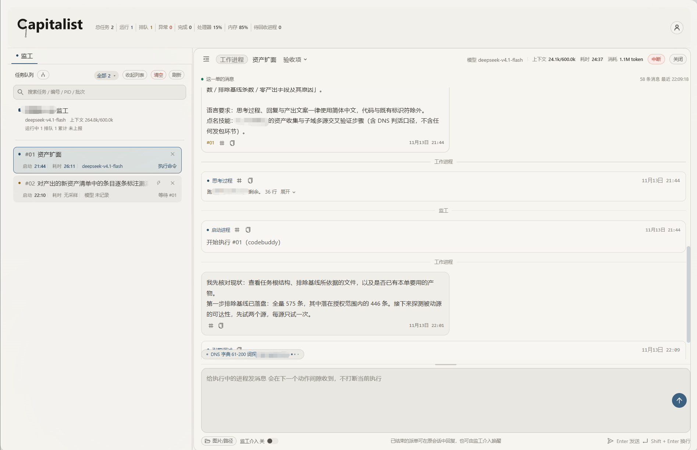

<div align="center">

# Capitalist

[](https://nodejs.org/)

[中文](README.md)
</div>

An AI automated multi-task scheduling plugin: each task keeps its own context and tasks can run concurrently, all coordinated by a supervisor process that maintains a separate in-process context and memory for every task while scheduling. Designed and tested by hand, coded with Deepseek-V4.1-Flash.

## What it does

`capitalist` is a cross-agent AI plugin that automates AI process scheduling and helps the user verify task results.

| Agent pain point | What this plugin does |
|---|---|
| Long tasks getting interrupted | The supervisor acts as the user: it adjudicates long tasks, lets work proceed, blocks violations, and reports on acceptance |
| Long contexts getting polluted | Every work process holds its own pid, session and context, sharing nothing; `capitalist reload` writes a progress snapshot, compacts heartbeats and completed items, switches session and produces a resume plan |
| Parallel work colliding | Parallel file operations are locked; for tasks with a contract, each `parallel` shard maps to one work process and changes are isolated per shard |
| Instructions having to be repeated | The host hook injects the current stage, unmet items and the next action at prompt submission. No user intervention is needed |

## Install

npm commands:

```bash
npm i -g capitalist
capitalist install --agent <host>   # choose a host; writes the hook and the supervisor manual
```

For `--agent` values see the "Supported hosts" table. Installation items are written for the selected host and nothing is written when none is given; on an interactive terminal the flag may be omitted and the installer shows a menu.

`capitalist install` must be run once after `npm i -g`: only then are the hook and the manual written, and hosts do not load the plugin without it.

Requirements: Node.js ≥ 18.17; macOS / Windows; the work-process host must offer a non-interactive entry point (`claude -p`, `codebuddy -p`).

### Install troubleshooting

| Symptom | Action |
|---|---|
| `npm i -g capitalist` reports `EEXIST .../bin/capitalist` | The path may hold a manual symlink or leftovers from an older version. Run `npm uninstall -g capitalist`; if it remains, move the file away and reinstall |
| Reports `EISDIR` or `ENOTEMPTY .../lib/node_modules/capitalist` | The directory is an older install or a symlink to the source, which npm cannot overwrite. Move the directory (`$(npm prefix -g)/lib/node_modules/capitalist`) and reinstall; it holds no task data |
| Reports `Your cache folder contains root-owned files` | The npm cache has a wrong owner. Run `sudo chown -R $(id -u):$(id -g) ~/.npm` and reinstall |
| `capitalist` points to the source directory after install | An earlier `npm link` or manual symlink. Check with `readlink -f $(which capitalist)`, move the symlink away and reinstall |
| The command disappears after install, or `command not found` | An older package with the same name exists globally (`package.json` has `name` set to `capitalist` as well) and npm removes the new link when it reshuffles `bin`. List `$(npm prefix -g)/lib/node_modules` and `$(npm prefix -g)/bin`, move the stale entry away and reinstall |

### Notes for WorkBuddy

- Without a terminal the host runs in "restricted mode". Clear it first, otherwise commands are unavailable.
- Starting the supervisor requires `--detach`. The host moves a long command to the background and returns immediately; the credentials are read while that command runs, which is when the authorization prompt can be triggered. On macOS the user must grant authorization; without `--detach`, or without authorization, the host reports "chat channel unavailable".
- WorkBuddy and CodeBuddy are installed together: the plugin runs in the WorkBuddy desktop app, work processes are carried by the CodeBuddy CLI, and the account credentials come from CodeBuddy.
- WorkBuddy restricts file access to the credential directory (Settings → Security → File security). Failing to allow it can break chat and dispatch.

## Quick use from a host

Send these to a host with the plugin installed (selecting the `capitalist` skill manually is recommended):

- Start a supervisor process and then leave it on standby.
- Start a supervisor process and finish the billing service refactor.
- Add a login-page integration task to the supervisor.
- Open a supervisor for this project and create a contract following the "xxx" skill workflow.

The host runs `capitalist supervise`, which creates the task root in the current directory and starts a resident supervisor; "add task" requests are appended with `capitalist say` and merged into the existing dispatch when work has not started, or delivered by the hook before the next tool call while it runs. See `skill/SKILL.md` for the trigger table.

When a third-party skill is referenced in a host, the supervisor can either generate a contract automatically following that skill's workflow, or split the skill by work content and attach the full skill address so work processes can fetch it themselves.

The supervisor panel is recommended for task supervision and scheduling. The startup log prints the board address, for example `http://127.0.0.1:7788/`, and the same address can be read from `board_url` in `capitalist status`. From the panel you can resume dispatches, inspect stages, interact with running work processes, write new instructions and adjudicate questions. The access key is not checked by default, but leaving it unchecked may pose an intranet security risk; starting with `--secure` prints an address carrying `?key=`, and the key changes on every start.

## Use cases

Tasks can be issued from the host directly or from the supervisor panel.

### 1. Coding tasks: frontend and backend in parallel

For coding tasks the supervisor can let frontend and backend proceed independently and start integration and automated-test processes once both are done.

You can: create a custom contract with frontend and backend as two `parallel` shards, one dispatch and one work process each; put integration and automated tests in later stages, which advance automatically once the previous stage is done.

### 2. Security tasks: batch dispatch and split by domain

For security tasks a skill can drive vulnerability hunting across several sites in one dispatch, with the supervisor enforcing redlines and accepting results as the skill requires; alternatively, split by site and dispatch by subdomain once asset collection is done.

You can split multiple sites into shards per site, split a single site into later-stage shards per subdomain, or dispatch several src hunting instructions in one go.

## Runtime panel



## Details

### Process model

| Role | How it starts | Responsibility |
|---|---|---|
| Supervisor process | `capitalist supervise`, resident | Creates the task root, draws up the contract, dispatches, accepts, reclaims and re-dispatches |
| Work process | Separate host process (`claude -p` / `codebuddy -p`) | Executes dispatches; holds its own pid, session and context, and reports back to the supervisor for acceptance once the task is done |
| Host hook | Called by the host at session lifecycle points | Injects state, judges commands against contract redlines and local boundaries |

`capitalist` ships three executables: the main command `capitalist`, the short alias `cap`, and the hook entry `capitalist-hook`. `capitalist board` serves a local board on `127.0.0.1:7788` (the port shifts when occupied, loopback only).

### Lifecycle of one task

1. In the project directory run `capitalist supervise "<target>" --contract minimal`. The command creates `.capitalist/`, writes `state.json` and `inbox/`, and starts the resident supervisor and the local board.
2. Click "resume dispatch" on the board or issue a new task there. The supervisor writes dispatches from the current stage's `next` / `parallel`, and each dispatch starts a separate work process.
3. In the work process session the host calls the hook on input submission, injecting the current stage, unmet items and the next action; before each tool call it judges the command against contract redlines and local boundaries and rejects it on a `BLOCK` hit.
4. The work process writes acceptance evidence with `capitalist record` and closes the dispatch with `capitalist report`. The supervisor accepts per stage; only when the gate passes does it advance, otherwise it re-dispatches.
5. State stays on disk after the session ends or the process exits. Running `capitalist supervise` again reuses the same task root; `capitalist reload` produces a snapshot and a resume plan, and the next dispatch adds a re-verification dispatch.

### Contract

A contract is a plain JSON file defining stages, gates, redlines and local boundaries. The repository ships `packages/supervisor/contracts/minimal.contract.json`, a basic three-stage flow.

```json
{
  "name": "my-domain",
  "domain": "domain name",
  "stages": [
    { "id": "S0", "name": "stage name", "goal": "why", "next": "next action",
      "done": { "type": "file_exists", "path": "docs/plan.md" } }
  ],
  "redlines": [
    { "id": "R1", "level": "BLOCK", "label": "forbidden",
      "pattern": "regex", "skip_if": "^(?:grep|rg)\\b", "fix": "the right way" }
  ],
  "local_guard": {
    "sensitive_paths": ["~/.ssh", "/etc"],
    "sensitive_names": [".env", "id_rsa"]
  }
}
```

A stage that declares `parallel` runs by shard; stages without it have a fixed parallelism of 1, and `--workers > 1` does not raise it. `--contract` accepts a built-in name or a path to a contract JSON; when a task root is created without one, a contract is generated from the target and the built-in contract is used if generation fails.

### Task root and data

`capitalist supervise` creates `.capitalist/` in the task directory. Main files:

| File | Content |
|---|---|
| `state.json` | Target, contract, current stage, next action |
| `inbox/dispatch.jsonl` / `inbox/qa.jsonl` | Dispatch queue / pending questions |
| `events.jsonl` / `tasks.jsonl` / `review.jsonl` | Event log / task pool / items awaiting review |
| `violations.jsonl` / `justify.jsonl` | Redline hits / registered out-of-bound reasons |
| `supervisor.json` / `workers/` | Supervisor heartbeat and board address / work process records and logs |
| `sessions.json` / `reload/` | Session registry / snapshots, compacted context and resume plans |

The directory is ignored by the repository `.gitignore`, so task data never enters version control.

### Common commands

| Purpose | Command |
|---|---|
| Start and stop | `capitalist supervise "<target>" --contract minimal`, `capitalist supervise-stop` |
| Pause and resume | `capitalist pause`, `capitalist resume` |
| Wake old dispatches | `capitalist wake [<dispatch id\|shard>]` (add `--user` on a non-interactive terminal) |
| Inspect state | `capitalist status`, `capitalist workers`, `capitalist board` |
| Advance and adjudicate | `capitalist advance`, `capitalist ask "<question>"`, `capitalist answer <id> "<guidance>"` |
| Intervene in running work | `capitalist say "<text>"`, `capitalist takeover [shard]`, `capitalist promote <target>` |
| Evidence and pre-checks | `capitalist record <name> <json>`, `capitalist ledger <add\|list\|assert>`, `capitalist gate --text '<command>'` |
| Context reload | `capitalist reload` |
| Install and remove | `capitalist install --agent <host>`, `capitalist uninstall`, `capitalist hosts` |
| Login state | `capitalist auth-check`, `capitalist auth status` (token source and expiry) |

All subcommands and flags are listed in `capitalist --help`; the split of duties between supervisor side and work-process side is in section 4 of `skill/SKILL.md`.

### Terms

| Term | Meaning |
|---|---|
| Host / hook | The agent CLI providing model calls and login state; the hook is the judging entry point it calls at session lifecycle points |
| Task root | A project directory containing `.capitalist/state.json`; commands search upward for the nearest one |
| Contract | Defines stages, gates, redlines and local boundaries |
| Stage / gate | Ordered steps in a contract and their `done` judgement; `capitalist advance` is rejected while a gate is unmet |
| Dispatch / shard | A work unit written by the supervisor to `inbox/dispatch.jsonl`; each `parallel` shard maps to one work process |
| Redline / local boundary | Command-text regex rules and path scope in a contract; levels are `BLOCK` / `NEED_USER` / `WARN` |
| Permission mode | `plan` / `default` / `accept_edits` / `bypass`, changing how strictly rules are judged |
| Acceptance evidence | JSONL files under `.capitalist/` recording requirements, changes, conclusions and violations |
| Board | A local HTTP visual page showing stages, dispatches, work processes and report history |

### Supported hosts

| Host | Config location | Notes |
|---|---|---|
| Claude Code | `~/.claude/settings.json` | Effective immediately |
| CodeBuddy | `~/.codebuddy/settings.json` | Unavailable in restricted environments when used as the work-process host |
| WorkBuddy | `~/.workbuddy/settings.json` | Same `hooks` structure as Claude Code; commands run through a POSIX shell |
| generic | — | Exit-code path when no host is detected |

### Scope and limits

Applicable: coding tasks spanning several sessions; tasks with stages and acceptance criteria; tasks that must retain changes and conclusions; tasks that change different files in parallel shards; agent sessions that need uniform blocking of destructive commands.

Not applicable: single-turn Q&A and one-off scripts; actions run directly in a terminal; judging the quality of the work. The hook only covers agent sessions that have it installed, and redlines only judge command text.

### Project layout

```
packages/supervisor/    npm package: engine, host implementations, CLI, installer
  src/core/             contracts, redlines, local boundaries, permission modes, stage gates, ledger
  src/agent/            interfaces + registry + dispatch; impl/<id>/ one directory per host
  src/cli/              capitalist command line
  src/supervisor/       resident supervisor: dispatch loop, work processes, board
  contracts/            built-in contracts: minimal
skill/                  agent manual (installed into each host's skills directory)
```

### License

Apache License 2.0. Copyright 2026 sl1126497036 (https://github.com/sl1126497036).

See [LICENSE](LICENSE) for the full text, [NOTICE](NOTICE) for attribution, and [THIRD-PARTY-NOTICES](THIRD-PARTY-NOTICES) for third-party licenses.
