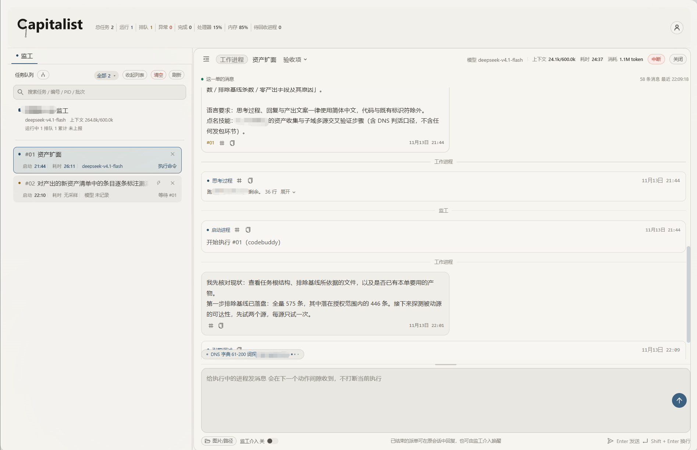

<div align="center">

# Capitalist

[](https://nodejs.org/)

[English](README.en.md)
</div>

这是一个 AI 自动化多任务调度插件： 每个任务上下文独立，可并发，由监工进程统一调度，调度时会单独维护一份上下文和记忆。本项目由人工设计，测试和Review，经 Deepseek-V4.1-Flash 编码实现。

当前项目处于测试阶段，尚不稳定。

## 工作内容

`capitalist` 是一个跨 Agent 的 AI 插件，用于自动化 AI 进程调度并帮助用户完成任务验收。


| Agent 痛点 | 本插件方案 |
|----|---|
| 长任务中断 | 监工扮演用户角色，对长任务自主裁决，进行放行、拦截、报告验收 |
| 长上下文污染 | 每个工作进程各自持有 pid、会话与上下文，互不共享；`capitalist reload` 写进度快照、压缩心跳与已完成明细、切换会话并生成恢复计划 |
| 并行冲突 | 对并行文件操作加锁；对存在契约的任务，`parallel` 分片各自对应一个工作进程，改动范围按分片隔离 |
| 反复输入指令 | 宿主 hook 在提交输入时注入当前阶段、未达标项与下一步动作。无需用户介入 |


## 安装

npm 命令：

```bash
npm i -g capitalist
capitalist install --agent <宿主>   # 选择要接入的宿主，写入 hook 与监工手册
```

`--agent` 取值见「宿主支持」表。安装项按所选宿主写入，未指定时不写入；交互终端下可省略，安装器会给出选择菜单。

`npm i -g` 之后须执行一次 `capitalist install`：hook 与手册才会写入，未执行时宿主不会加载本插件。

环境要求：Node.js ≥ 18.17；macOS / Windows；工作进程宿主需提供非交互入口（`claude -p`、`codebuddy -p`）。


### 安装故障

| 现象 | 处理 |
|---|---|
| `npm i -g capitalist` 报 `EEXIST .../bin/capitalist` | 该路径可能存在手工软链或旧版残留。执行 `npm uninstall -g capitalist`，仍存在时移走该文件再安装 |
| 报 `EISDIR` 或 `ENOTEMPTY .../lib/node_modules/capitalist` | 该目录为旧安装或指向源码的软链，npm 无法覆盖。移走该目录（`$(npm prefix -g)/lib/node_modules/capitalist`）后重装；该目录不承载任务数据 |
| 报 `Your cache folder contains root-owned files` | npm 缓存目录属主异常。执行 `sudo chown -R $(id -u):$(id -g) ~/.npm` 后重装 |
| 安装后 `capitalist` 指向源码目录 | 曾用 `npm link` 或手工软链。`readlink -f $(which capitalist)` 确认指向，移走该软链后重新安装 |
| 安装后命令立即消失，或 `command not found` | 全局目录里存在同名旧包（`package.json` 的 `name` 同为 `capitalist`），npm 重排 `bin` 时删掉新链接。列出 `$(npm prefix -g)/lib/node_modules` 与 `$(npm prefix -g)/bin`，移走改名或指向源码的旧条目后重装 |

### WorkBuddy 中的注意事项

- 无终端可用时处于“受限模式”，需先解除，否则命令不可用。
- 启动监工必须加 `--detach`。宿主把长命令转入后台执行，命令随即返回；凭证读取发生在这条命令执行期间，才能触发授权询问提醒。macOS下必须取得用户授权，未加`--detach`或未授权时报“对话通道不可用”。
- WorkBuddy 与 CodeBuddy 需合并安装：插件在 WorkBuddy 桌面端使用，工作进程由 CodeBuddy CLI 承担，账号凭证来自 CodeBuddy。
- WorkBuddy 对凭证目录设有文件访问限制（设置 → 安全 → 文件安全）。未放行时可能导致对话与派单失败。


## 在宿主中快捷使用

对已安装本插件的宿主下达指令（建议手动选择`capitalist`skill后执行）：

- 帮我启动一下监工进程然后待命。
- 帮我启动一个监工进程，并完成计费服务重构。
- 给监工加派一个登录页联调任务。
- 给这个项目开一个监工，并按“xxx”skill流程创建契约。

宿主执行 `capitalist supervise`，在当前目录创建任务根并拉起常驻监工；“加派”类需求由 `capitalist say` 追加到派单，未开工的并入原派单，执行中的由 hook 在下次工具调用前送达。触发词表见 `skill/SKILL.md`。

在宿主中引用第三方skill时，监工可以按skill流程自动生成契约，也可以按工作内容拆分skill，并附上完整skill技能地址供工作进程自取。

推荐使用监工面板进行任务监管和调度。启动日志会输出看板地址，形如 `http://127.0.0.1:7788/`，也可以通过`capitalist status` 的 `board_url` 查看面板地址。面板可恢复派单、查看阶段，可与在途工作进程、写入新指令、裁决提问。访问 key 缺省时不做校验，但是可能存在内网安全问题；以 `--secure` 启动时将输出带 `?key=` 地址，key 每次启动变更。

## 使用场景

任务可在宿主中直接下发，也可通过监工面板下发。

### 1. 编码任务：前后端并行

编码任务中，监工可按项目需求让前后端独立推进，待前后端编码完成后，再创建联调和自动化测试进程。

你可以：创建自定义契约，把前端与后端写成两个 `parallel` 分片，每片一张派单、一个工作进程；把联调与自动化测试写成后续阶段，前一阶段完成后自动推进下一阶段。

### 2. 网络安全任务：批量下发与分域拆分

网络安全任务中，可结合 skill 一次性下发多个网站的漏洞挖掘工作，由监工按 skill 要求执行红线监督与结果验收；也可按单个网站分工，在资产采集完成后按子域下发给多个进程。
你可以多站点按站点拆成分片，也可以单站点按子域拆成后续阶段的分片，还可以一次性下发多个src挖掘指令。
## 运行时看板



## 详细介绍

### 进程模型

| 角色 | 启动方式 | 职责 |
|---|---|---|
| 监工进程 | `capitalist supervise`，常驻 | 创建任务根、制定契约、派单、验收、回收重派 |
| 工作进程 | 独立宿主进程（`claude -p` / `codebuddy -p`） | 执行派单任务，各自持有 pid、会话与上下文，任务完成后将上报监工验收 |
| 宿主 hook | 宿主在会话生命周期点调用 | 注入状态、按契约红线与本机边界判定命令 |

`capitalist` 提供三个可执行文件：主命令 `capitalist`、短名 `cap`、hook 入口 `capitalist-hook`。`capitalist board` 在 `127.0.0.1:7788` 提供本地看板（端口占用时顺延，仅本机可访问）。

### 一次任务的流程

1. 在项目目录执行 `capitalist supervise "<目标>" --contract minimal`。命令创建 `.capitalist/`，写入 `state.json` 与 `inbox/`，启动常驻监工与本地看板。
2. 在看板点“恢复派单”或下发新任务。监工按当前阶段的 `next` / `parallel` 写入派单，每张派单拉起一个独立工作进程。
3. 工作进程会话中，宿主在提交输入时调用 hook，注入当前阶段、未达标项与下一步动作；在工具调用前按契约红线与本机边界判定命令，命中 `BLOCK` 时拒绝执行。
4. 工作进程使用 `capitalist record` 写验收凭据、用 `capitalist report` 结单。监工按阶段验收；门槛达标才推进到下一阶段，未达标时重派。
5. 会话结束或进程退出后状态仍在磁盘。重新执行 `capitalist supervise` 续用同一任务根；`capitalist reload` 生成快照与恢复计划，下一派单补出复验单。

### 契约

契约是纯 JSON 文件，定义阶段、门槛、红线与本机边界。仓库内置 `packages/supervisor/contracts/minimal.contract.json`，提供基础三阶段流程。

```json
{
  "name": "my-domain",
  "domain": "领域名",
  "stages": [
    { "id": "S0", "name": "阶段名", "goal": "为什么做", "next": "下一步动作",
      "done": { "type": "file_exists", "path": "docs/plan.md" } }
  ],
  "redlines": [
    { "id": "R1", "level": "BLOCK", "label": "禁止项",
      "pattern": "正则", "skip_if": "^(?:grep|rg)\\b", "fix": "正确做法" }
  ],
  "local_guard": {
    "sensitive_paths": ["~/.ssh", "/etc"],
    "sensitive_names": [".env", "id_rsa"]
  }
}
```

阶段声明 `parallel` 后按分片并行；未声明的阶段并行度固定为 1，传入 `--workers > 1` 不增加并行度。`--contract` 接受内置名称或契约 JSON 路径；新建任务根且未指定契约时按目标生成，生成失败时回落内置契约。

### 任务根与数据

`capitalist supervise` 在任务目录下创建 `.capitalist/`，主要文件：

| 文件 | 内容 |
|---|---|
| `state.json` | 目标、契约、当前阶段、下一步动作 |
| `inbox/dispatch.jsonl` / `inbox/qa.jsonl` | 派单队列 / 待裁决问题 |
| `events.jsonl` / `tasks.jsonl` / `review.jsonl` | 事件台账 / 任务池 / 待复核项 |
| `violations.jsonl` / `justify.jsonl` | 红线命中 / 已登记的越界理由 |
| `supervisor.json` / `workers/` | 监工心跳与看板地址 / 工作进程记录与日志 |
| `sessions.json` / `reload/` | 会话登记 / 快照、压缩上下文与恢复计划 |

该目录由仓库 `.gitignore` 忽略，任务数据不进入版本库。

### 常用命令

| 用途 | 命令 |
|---|---|
| 启动与停止 | `capitalist supervise "<目标>" --contract minimal`、`capitalist supervise-stop` |
| 暂停与恢复 | `capitalist pause`、`capitalist resume` |
| 唤醒旧派单 | `capitalist wake [<派单id\|分片>]`（非交互终端加 `--user`） |
| 查看状态 | `capitalist status`、`capitalist workers`、`capitalist board` |
| 推进与裁决 | `capitalist advance`、`capitalist ask "<问题>"`、`capitalist answer <id> "<指导>"` |
| 干预在途任务 | `capitalist say "<文本>"`、`capitalist takeover [分片]`、`capitalist promote <目标>` |
| 证据与预检 | `capitalist record <名> <json>`、`capitalist ledger <add\|list\|assert>`、`capitalist gate --text '<命令>'` |
| 上下文重载 | `capitalist reload` |
| 安装与卸载 | `capitalist install --agent <宿主>`、`capitalist uninstall`、`capitalist hosts` |
| 登录态 | `capitalist auth-check`、`capitalist auth status`（令牌来源与到期时间） |

全部子命令与参数见 `capitalist --help`；监工侧与工作进程侧的职责划分见 `skill/SKILL.md` 第 4 节。

### 术语

| 术语 | 含义 |
|---|---|
| 宿主 / hook | 提供模型调用与登录态的 agent CLI；hook 是它在会话生命周期点调用的判定入口 |
| 任务根 | 含 `.capitalist/state.json` 的项目目录；命令向上查找最近的一个 |
| 契约 | 定义阶段、门槛、红线与本机边界 |
| 阶段 / 门槛 | 契约中的有序步骤与 `done` 判定；未达标时 `capitalist advance` 被拒绝 |
| 派单 / 分片 | 监工写入 `inbox/dispatch.jsonl` 的工作单元；`parallel` 分片各自对应一个工作进程 |
| 红线 / 本机边界 | 契约中的命令文本正则规则与路径范围；级别为 `BLOCK` / `NEED_USER` / `WARN` |
| 权限档位 | `plan` / `default` / `accept_edits` / `bypass`，改变规则判定尺度 |
| 验收凭据 | `.capitalist/` 下的 JSONL 文件，记录需求、改动、结论与违规 |
| 看板 | 本地 HTTP可视化页面，展示阶段、派单、工作进程与回报流水 |

### 宿主支持

| 宿主 | 配置位置 | 说明 |
|---|---|---|
| Claude Code | `~/.claude/settings.json` | 写入即生效 |
| CodeBuddy | `~/.codebuddy/settings.json` | 作为工作进程宿主时在受限环境不可用 |
| WorkBuddy | `~/.workbuddy/settings.json` | 与 Claude Code 同一套 `hooks` 结构；命令经 POSIX shell 执行 |
| generic | — | 探测不到宿主时的退出码通路 |

### 适用范围与限制

适用：跨多个会话的编码任务；有阶段与验收判据的任务；需要留存改动与结论记录的任务；按分片并行改动不同文件的任务；需要对破坏性命令做统一拦截的 agent 会话。

不适用：单轮问答与一次性脚本；终端里直接执行的动作；工作内容的质量判定。hook 只覆盖装有它的 agent 会话，红线只判定命令文本。

### 项目结构

```
packages/supervisor/    npm 包：引擎、宿主实现、CLI、安装器
  src/core/             契约、红线、本机边界、档位、阶段闸、台账
  src/host/             接口 + 注册表 + 分派；impl/<id>/ 每个宿主一个目录
  src/cli/              capitalist 命令行
  src/supervisor/       常驻监工进程：派单循环、工作进程、看板
  contracts/            内置契约：minimal
skill/                  agent 手册（安装到各宿主的 skills 目录）
```

### 许可证

Apache License 2.0。Copyright 2026 sl1126497036 (https://github.com/sl1126497036)。

全文: [LICENSE](LICENSE)，归属声明: [NOTICE](NOTICE)，第三方组件许可: [THIRD-PARTY-NOTICES](THIRD-PARTY-NOTICES)。
